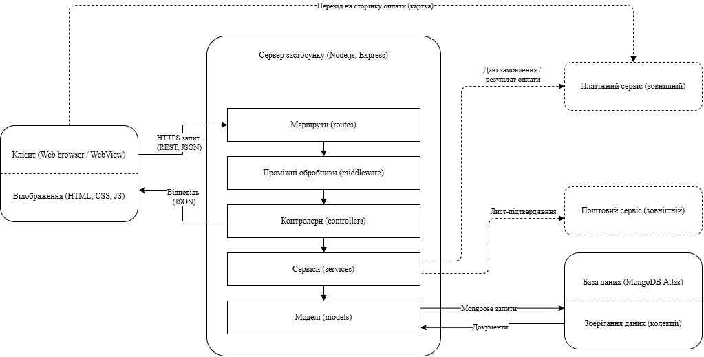
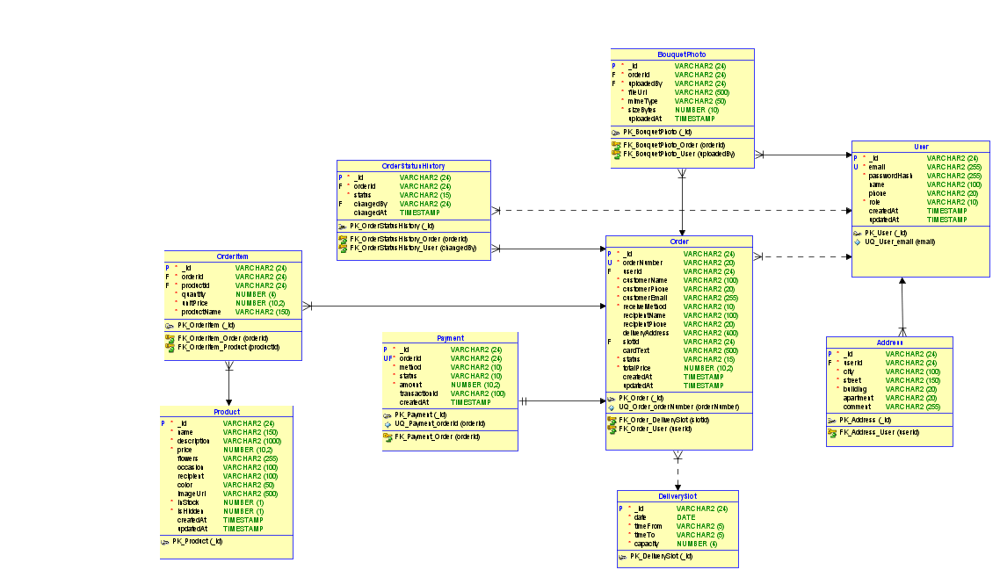
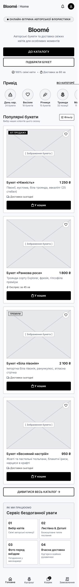
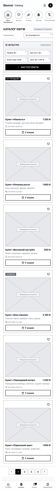
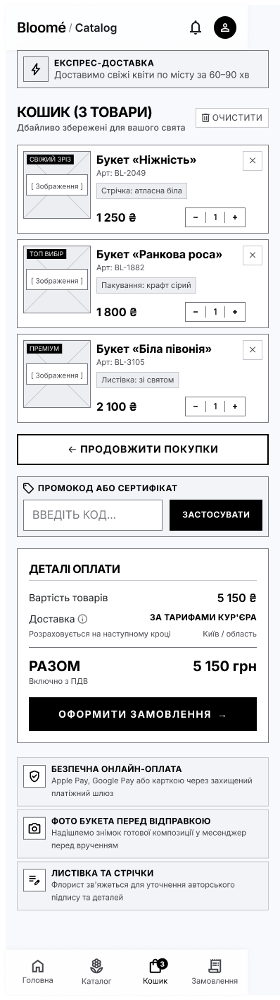
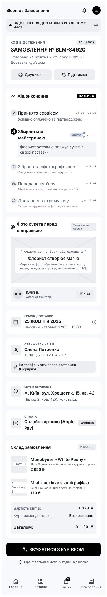
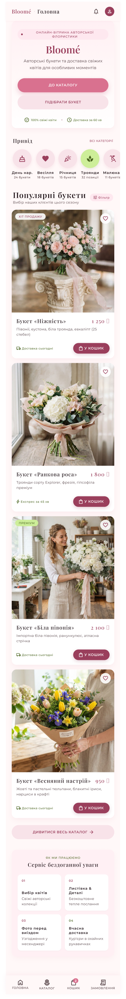
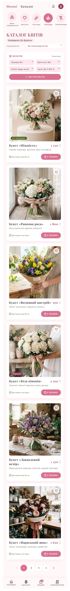
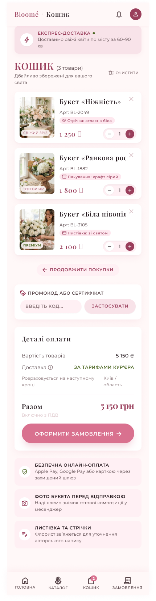
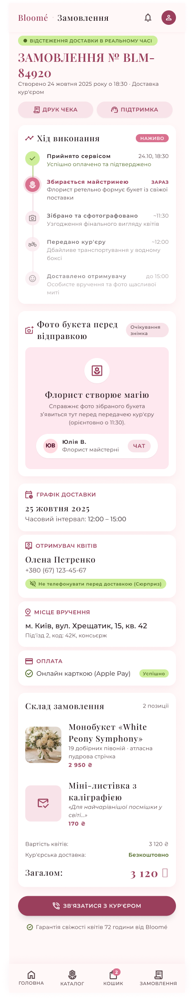

# Bloomé: результати лабораторної роботи №3 (ТСПП)

У цьому каталозі зібрано результати проєктування застосунку квіткового магазину Bloomé: архітектура, модель даних, каркаси та макети екранів.

### Архітектурний стиль і архітектурна діаграма

Обрано трирівневу клієнт-серверну архітектуру: клієнт (HTML, CSS, JavaScript у браузері або WebView), REST API на Node.js і Express та база даних MongoDB Atlas. Усередині сервер монолітний і поділений на шари: routes, middleware, controllers, services, models. Такий стиль простіший для одного розробника, ніж мікросервіси, і дозволяє окремо захистити сервер і дані. На діаграмі показано ці рівні та зовнішні платіжний і поштовий сервіси, які позначено за ролями без вибору конкретних.

### ER-діаграма

Логічну модель даних складають 9 сутностей: User, Address, Product, DeliverySlot, Order, OrderItem, Payment, BouquetPhoto і OrderStatusHistory. Замовлення пов'язане з товарами через OrderItem, з оплатою один до одного, а історія статусів і фото букета належать замовленню. У MongoDB сутності відображено на 5 колекцій: users, products, deliverySlots, orders і payments, а адреси, позиції, фото та історію статусів вкладено в масиви. Сутність Product не змінювалась, бо вона вже реалізована в серверній частині.

### Каркаси екранів

Каркаси показують розташування елементів чотирьох екранів покупця: «Головна», «Каталог», «Кошик» і «Статус замовлення». Екрани зроблено як мобільну версію шириною 390 px, щоб виконувалась вимога NFR-004 (коректний вигляд від 360 px). Унизу є меню з чотирьох вкладок: «Головна», «Каталог», «Кошик» і «Замовлення». На екрані статусу етапи йдуть у порядку з вимог: Прийнято, Збирається, Зібрано, Передано кур'єру, Доставлено.

### Макети екранів

Макети - це ті самі чотири екрани з кольорами, шрифтами та реальними підписами. Фон сторінки #FFF5F7, картки білі із заокругленням 16 px, головний акцент #D9718F, темно-рожевий #B8567A, оливковий #7D9A4F для підписів, текст #3B2E33. Для заголовків використано шрифт Playfair Display, для тексту Montserrat, бо він підтримує кирилицю. Кнопки мають форму пілюлі: залита для головної дії та контурна для другорядної.
